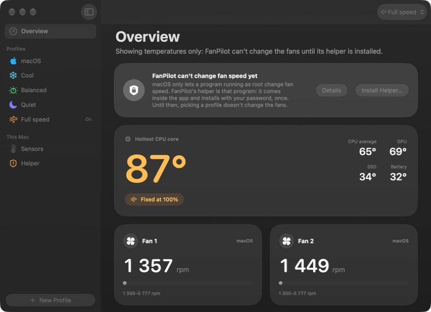

# FanPilot

[](https://github.com/antonarnaudov/FanPilot/releases/latest)
[](https://github.com/antonarnaudov/FanPilot/actions/workflows/ci.yml)


[](LICENSE)

**Fine-grained fan control for Apple Silicon Macs.** You decide when the fans come on, how hard they run and when they give control back to macOS.



## Why

macOS keeps the fans quiet for as long as it can. On an Apple M4 Pro laptop we measured the hottest CPU core at **110 °C while both fans sat at about 1,350 RPM**, their minimum (heavy Swift build, power adapter, macOS 27). FanPilot lets you trade some noise for a cooler machine, and only when you want to.

> **Status: 0.2.4, early.** Tested on Apple M4 Pro with macOS 27: the built-in helper takes both fans, holds them steady on Silent Cool and Full speed, and hands them back to macOS on demand. Other Macs, sleep/wake and long heavy loads are less tested; Intel and M5 support is written but untested. Reports from other Macs are very welcome.

## What it does

- **Profiles** you switch from the menu bar: *macOS* (Apple's default), *Silent Cool* (fans on early but kept in the inaudible range), *Cool*, *Balanced*, *Quiet*, *Full speed*, and your own. Every profile can be edited, duplicated or reset; create new ones with **+** in the menu bar window or **New Profile** in the app.
- **Curves**: fan speed follows a temperature through points you drag on a chart or type in exactly.
- **When the fans come on**: a take-over temperature and a lower give-back temperature, plus how long it must stay cooler before macOS gets the fans back (60 s by default, so brief dips don't flip control). Or keep them at minimum speed instead.
- **Response tuning**: hysteresis, smoothing, spin-up and spin-down rates, and a hold time before slowing down, so the fans don't chase every spike.
- **Which sensor**: hottest CPU core, CPU average, GPU, hottest of CPU and GPU, SSD, battery, or any single SMC sensor.
- **Per-fan overrides**: different settings for the left and right fans.
- **On battery**: optionally switch to another profile (for example *macOS*) while unplugged.
- **Safety**: every fan FanPilot controls goes to full speed when the hottest CPU/GPU sensor stays at a limit (95 °C for 5 s by default).
- **Monitoring without root**: about 300 live temperature sensors, fan speeds, and a 10-minute history.
- **Runs without the app**: a small root helper runs your profile from boot. The menu bar app is only the remote control.

It's designed in Apple's current design language, Liquid Glass: a floating glass sidebar, glass cards and controls with large rounded readouts, a heat map of every sensor, a menu bar window laid out like Control Center, and light and dark mode.

## Download

Requires an Apple Silicon Mac with **macOS 26 or later**.

1. Download **FanPilot-x.y.z.dmg** from the [latest release](https://github.com/antonarnaudov/FanPilot/releases/latest), open it and drag **FanPilot** onto **Applications**.
2. Open FanPilot from Applications. FanPilot isn't notarized by Apple yet (no Developer ID), so the first time macOS says it can't check the app. Click **Done**, then go to **System Settings → Privacy & Security**, scroll to *"FanPilot" was blocked* and click **Open Anyway**. Or, in Terminal:
   ```bash
   xattr -dr com.apple.quarantine /Applications/FanPilot.app
   ```
3. Allow the fan helper. It's built into the app; there is no separate installer. FanPilot registers it with macOS (Apple's `SMAppService`) and macOS asks you once: click **Open Login Items…** in FanPilot and turn FanPilot on under *Allow in the Background*.

Pick a profile from the fan icon in the menu bar. Deleting FanPilot removes the helper with it. Each release lists SHA-256 checksums in `SHA256SUMS.txt`.

## Build from source

Needs macOS 26 or later and Xcode 26 or later.

```bash
git clone https://github.com/antonarnaudov/FanPilot.git
cd FanPilot
make install        # builds build/FanPilot.app, copies it to /Applications and opens it
```

Then allow the helper as in step 3 above.

### Check fan control from Terminal (optional)

```bash
sudo /Applications/FanPilot.app/Contents/MacOS/fanpilotctl test 3500 10
```

This takes both fans, holds them at 3,500 RPM for 10 seconds while printing the real speed, then gives them back to macOS (stop FanPilot's helper first, or two programs will fight over the fans). Ctrl-C at any point gives the fans back.

## Using it

- **Menu bar**: the hottest CPU temperature and the fastest fan. Click it for temperatures, fans, and one-click profile switching.
- **Open FanPilot**: the overview, profile editing, a heat map of every sensor, and the helper's activity log. While the window is open FanPilot also shows in the Dock and the menu bar, like other menu bar apps.
- **Settings… (⌘,)**: what the menu bar shows, a profile for battery power, how often the helper updates, the safety limit, and opening at login.
- **Profile icons**: click a profile's icon to pick its symbol and colour; double-click its name to rename it.
- A profile in **Curve** mode has three parts:
  1. **Curve**: 0 % is the fan's minimum speed and 100 % its maximum. Drag points, double-click to add one, or type exact values.
  2. **When the fans come on**: *Take over at* (for example 60 °C) and *Give back below* (for example 54 °C). The gap stops the fans from switching on and off.
  3. **Response**: *Hysteresis* (speed drops only once the temperature has fallen this far), *Smoothing* (seconds of averaging), *Spin-up / Spin-down rate* (RPM per second), *Hold before slowing* (seconds).

### Command line

`fanpilotctl` lives inside the app: `/Applications/FanPilot.app/Contents/MacOS/fanpilotctl`.

```text
fanpilotctl status                 fans and the main temperatures
fanpilotctl sensors [--all]        live temperature sensors
fanpilotctl keys [prefix]          raw SMC keys, e.g. `keys F`
fanpilotctl helper                 what the helper is doing and its recent activity
fanpilotctl profile Cool           switch profile
sudo fanpilotctl test [rpm] [s]    take the fans, hold, give them back
sudo fanpilotctl auto              give every fan back to macOS (recovery)
```

## How it works

```text
FanPilot.app (menu bar, your user)  ──XPC──▶  fanpilotd (root, inside the app)  ──IOKit──▶  AppleSMC
  reads sensors directly (no root)              runs the control loop each second
  edits profiles                                writes fan mode + target speed
```

- **SMC**: temperatures and fan speeds are SMC keys, read through the `AppleSMC` IOKit user client. On Apple Silicon fan values are little-endian floats (`F0Ac` actual, `F0Mn`/`F0Mx` limits, `F0Tg` target, `F0Md` mode).
- **The M3/M4 lock**: macOS's thermal manager owns the fans (mode 3), and the firmware refuses a manual-mode write until the diagnostic flag `Ftst` is set to 1. FanPilot sets `Ftst`, retries the mode write until macOS lets go (usually 1–6 s), then sets the target speed. M5 uses a lowercase `F0md` with no `Ftst`; Intel uses the `FS! ` bitmask. Both are supported in code; neither has been tested.
- **Giving back**: per fan, mode 0, then `Ftst` back to 0 once no fan is manual, so macOS's thermal management is fully restored. The helper does this when your profile says so, before sleep, when it stops (uninstall, `launchctl bootout`, SIGTERM), and at start-up if a crash left the fans forced.
- **Sensors**: every SMC `T…` key with a float value is a candidate. Keys that sit at a round number and never move are placeholders and stay out of the summaries until they change. On an M4 Pro, `Tp…`/`Te…` are CPU, `Tg…` GPU, `TH…` SSD and `TB?T` battery.
- **Control step** (`CurveEngine`): smooth the temperature → apply the start/stop thresholds → apply hysteresis → read the curve → limit the rate of change → hold before slowing down. The safety override comes first.

## Safety and recovery

- FanPilot never writes speeds outside the fan's own min–max range. The safety limit forces full speed on any fan it controls.
- If the fans ever look stuck, run `sudo fanpilotctl auto`, or restart the Mac: the SMC resets on boot.
- **Uninstall**: in the app, Helper → Turn Off (the fans go back to macOS), then delete the app.

## Development

```bash
make build          # swift build
make test           # unit tests (control engine, SMC codec, config)
make app            # build/FanPilot.app (ad-hoc signed; SIGN_IDENTITY=… for a real identity)
make dev-helper     # run the helper as your user in dry-run mode (never writes to the SMC)
defaults write com.antonarnaudov.fanpilot devHelper -bool true   # point the app at it
make release        # build/release: DMG, zip and SHA256SUMS (notarized when NOTARY_PROFILE is set)
make screenshots    # render every screen offscreen to build/snapshots (layout only: no glass offscreen)
FANPILOT_PAGE=sensors FANPILOT_APPEARANCE=light open build/FanPilot.app   # open on a page for design review
```

| Path | What |
|---|---|
| `Sources/CSMC` | C layout of the 80-byte AppleSMC call structure |
| `Sources/SMCKit` | Reading and writing SMC keys, value encoding |
| `Sources/FanPilotCore` | Sensors, fans, `FanController` (unlock/release), `CurveEngine`, config, XPC protocol |
| `Sources/fanpilotd` | The root helper: control loop, XPC service, sleep/wake |
| `Sources/fanpilotctl` | Command-line tool |
| `Sources/FanPilotApp` | SwiftUI menu bar app |
| `Resources/com.antonarnaudov.fanpilot.helper.plist` | The helper's launchd definition, embedded in the app and registered with SMAppService |

## Credits

The M3/M4 `Ftst` unlock was worked out by others and shared under the MIT license. The research by [agoodkind/macos-smc-fan](https://github.com/agoodkind/macos-smc-fan) and the implementations in [whybepb/fan-dial](https://github.com/whybepb/fan-dial) and [raminsharifi/MacFanControl](https://github.com/raminsharifi/MacFanControl) documented the sequence; see also [exelban/stats#2928](https://github.com/exelban/stats/issues/2928). FanPilot's code is its own.

FanPilot is not affiliated with Apple or with the makers of other fan-control apps.

## License

[MIT](LICENSE)
